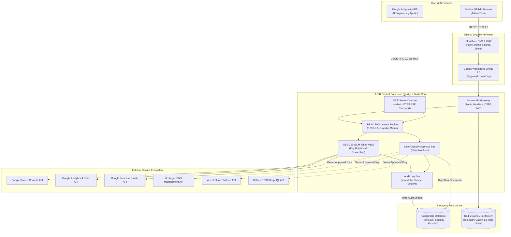
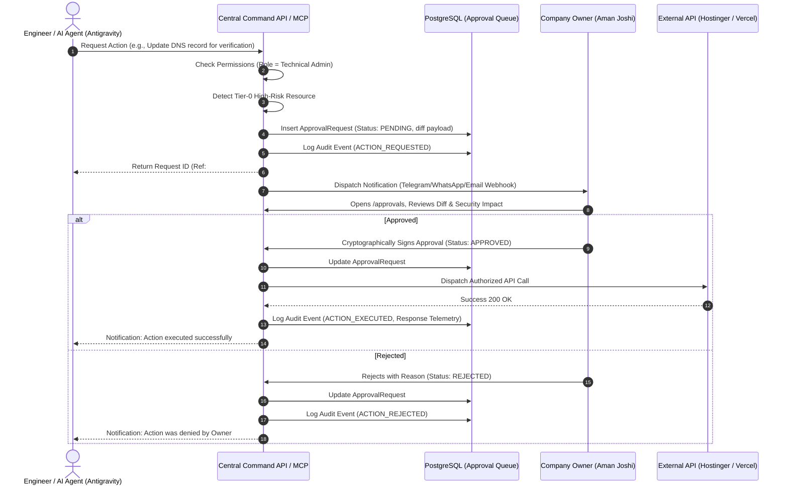

# AJPR Central Command — Architecture Specification (Phase 1)

> **Document Version**: 1.0.0  
> **Status**: APPROVED FOR REVIEW (Phase 1 Planning)  
> **Target Application**: AJPR Central Command (`ajpr-central-command`)  
> **Entity**: AJPR World Private Limited  
> **Lead Architect**: AI Systems Architecture Team (Google Antigravity IDE)  
> **Classification**: Confidential — Internal Company Infrastructure  

---

## 1. Executive Summary & Purpose

**AJPR Central Command** is a dedicated enterprise operations and digital governance platform designed for **AJPR World Private Limited**. It unifies infrastructure management, marketing telemetry, domain operations, repository workflows, and team access into a single, high-security operational plane.

The platform provides a **dual control surface**:
1. **Web-Based Admin Portal**: A modern, responsive web application for human team members (Company Owner, Admins, SEO, Marketing, Finance).
2. **Google Antigravity MCP Server (`mcp-ajpr-command`)**: A Model Context Protocol server that allows AI engineering agents inside the Google Antigravity IDE to securely inspect telemetry, query analytics, and prepare operational changes under strict approval controls.

```
┌─────────────────────────────────────────────────────────────────────────────┐
│                       AJPR WORLD CENTRAL COMMAND                            │
│                                                                             │
│  ┌─────────────────────────┐               ┌─────────────────────────────┐  │
│  │   HUMAN CONTROL PLANE   │               │      AI CONTROL PLANE       │  │
│  │   Next.js Admin Panel   │               │   Google Antigravity IDE    │  │
│  │ (command.ajprworld.com) │               │   (MCP Client / Claude)     │  │
│  └────────────┬────────────┘               └──────────────┬──────────────┘  │
│               │                                           │                 │
│               ▼                                           ▼                 │
│      [ Google OAuth 2.0 ]                        [ MCP JSON-RPC 2.0 ]       │
│      [ Session / MFA / RBAC ]                    [ Tool Verification ]      │
│               │                                           │                 │
│               └───────────────────┬───────────────────────┘                 │
│                                   │                                         │
│                                   ▼                                         │
│                  ┌──────────────────────────────────┐                       │
│                  │   CENTRAL COMMAND CORE BACKEND   │                       │
│                  │   • RBAC Policy Enforcement Engine                       │
│                  │   • Dual-Custody Approval Engine │                       │
│                  │   • AES-256-GCM Token Vault      │                       │
│                  │   • Immutable Audit Logging Bus  │                       │
│                  └────────────────┬─────────────────┘                       │
│                                   │                                         │
│       ┌───────────────────────────┼───────────────────────────┐             │
│       ▼                           ▼                           ▼             │
│  [ PostgreSQL ]          [ Google Cloud APIs ]       [ DevOps & Hosting ]   │
│  • Users & Roles         • Search Console API        • Hostinger DNS API    │
│  • Approval Queue        • GA4 Analytics Data API    • Vercel Platform API  │
│  • Immutable Audit Log   • Business Profile API      • GitHub GraphQL API   │
│  • Encrypted Secrets     • Cloudflare Zero Trust     • Skydo / Payments     │
└─────────────────────────────────────────────────────────────────────────────┘
```

---

## 2. Infrastructure Separation Proposal: Public Site vs. Central Command

### 2.1 The Need for Independent Repositories
The existing repository (`sabse_new_ajpr`) powers the public marketing website [`https://ajprworld.com`](https://ajprworld.com). Central Command **MUST** be provisioned as a **separate, decoupled repository** (`ajpr-central-command`).

| Vector | Public Site (`sabse_new_ajpr`) | Central Command (`ajpr-central-command`) |
| :--- | :--- | :--- |
| **Audience** | Public global web visitors, prospects, search spiders | Internal authenticated team members & Antigravity IDE |
| **Domain** | `ajprworld.com` | `command.ajprworld.com` (SSO & IP protected) |
| **Privilege Level** | Zero administrative authority | Root infrastructure, DNS, GitHub, Analytics, Vercel |
| **Blast Radius** | Low (Content, marketing, lead forms) | Critical (Production domains, DNS records, API keys) |
| **Deployment Flow** | Standard CI/CD on Git push | Staged deployment with manual Company Owner sign-off |
| **Network Boundary**| Public CDN Edge (Vercel) | Edge Firewall + Google Workspace Single Sign-On |

### 2.2 Repository Architecture Recommendation
```
GitHub Organization: AJPR-World / Aman-Joshi989
│
├── [Existing] sabse_new_ajpr          ──> Public Next.js 16 Website (ajprworld.com)
└── [Proposed] ajpr-central-command    ──> Unified Admin & MCP Command (command.ajprworld.com)
```

---

## 3. System Architecture & Topology



---

## 4. Component Breakdown

### 4.1 Web-Based Admin Panel (`apps/web`)
- **Framework**: Next.js 15+ (App Router, React 19, TypeScript).
- **Styling**: Tailwind CSS + shadcn/ui + Radix UI primitives.
- **State Management**: TanStack Query (React Query) for telemetry polling with optimistic updates.
- **Charts & Telemetry**: Recharts / Tremor for SERP visibility, traffic curves, and Core Web Vitals.
- **Layout Structure**:
  - `/overview`: High-level operational health, active approval requests, top traffic KPIs.
  - `/analytics`: Unified Google Search Console & GA4 real-time explorer.
  - `/approvals`: Dedicated dual-custody inbox for Company Owner / Super Admin.
  - `/integrations`: Health status, scope inspection, and revocation console for all connected providers.
  - `/team`: User invitations, role assignments, session terminations.
  - `/audit-log`: Searchable, filterable real-time event ledger.

### 4.2 Google Antigravity MCP Server (`packages/mcp-server`)
- **Protocol**: Model Context Protocol (MCP) by Anthropic / Linux Foundation.
- **Transport**: Standard Input/Output (`stdio`) for local IDE integration, with optional secure Server-Sent Events (`SSE`) over HTTPS for remote clusters.
- **Security Guardrails**:
  - Every tool call executes within a sandboxed context validated by the user's active session.
  - Destructive tools (e.g., `modify_dns_record`, `deploy_production`) do **NOT** execute directly; they generate a pending `ApprovalRequest` record in the database and notify the Company Owner.
  - Read tools (e.g., `get_search_console_metrics`, `list_vercel_deployments`) execute instantly with role-based redaction of sensitive credentials.

### 4.3 Database Layer (PostgreSQL)
- **Deployment**: Managed PostgreSQL (Supabase / Neon / AWS Aurora) with automated daily snapshots and point-in-time recovery (PITR).
- **Row Level Security (RLS)**: Enforces data isolation between roles directly at the database engine level.
- **Connection Management**: PgBouncer pooling for sub-millisecond query latency.

---

## 5. End-to-End Approval Workflow (Two-Man Rule)

Destructive actions (Hostinger DNS changes, Vercel production promotions, repository privilege escalation) cannot be executed unilaterally by any single engineer or AI agent.



---

## 6. Technology Stack Matrix

| Tier | Component | Selection | Justification |
| :--- | :--- | :--- | :--- |
| **Frontend** | Application Framework | Next.js 15+ (App Router) | Native React Server Components, high performance, enterprise TypeScript support |
| **Frontend** | UI Components | shadcn/ui + Radix UI | Accessible, unstyled primitives with full source control ownership |
| **Frontend** | Data Visualization | Recharts + Tremor | Lightweight SVG charts for organic clicks, impressions, and server metrics |
| **AI Protocol**| Tool Integration | Model Context Protocol (MCP) | Sanctioned Antigravity IDE standard for tool calling and context hydration |
| **Backend** | Runtime & API | Node.js 22 LTS / Edge API Routes | Fast startup, comprehensive Google SDK compatibility, native crypto |
| **Auth** | Identity Provider | Google Workspace OAuth 2.0 | Native corporate email enforcement (`@ajprworld.com`) with 2FA |
| **Database** | Primary Relational DB | PostgreSQL 16+ | ACID compliance, JSONB support, Row Level Security, rock-solid reliability |
| **Secrets** | Token Encryption | AES-256-GCM Envelope Encryption | Hardware-accelerated cryptographic protection for external API tokens |
| **Audit** | Event Ledger | Tamper-evident PostgreSQL Stream | Cryptographic hash chaining ensures records cannot be altered retroactively |

---

## 7. Next Steps & Approval Gate
Implementation of AJPR Central Command is strictly frozen in Phase 1 pending formal review and digital signature from Company Owner Aman Joshi.
